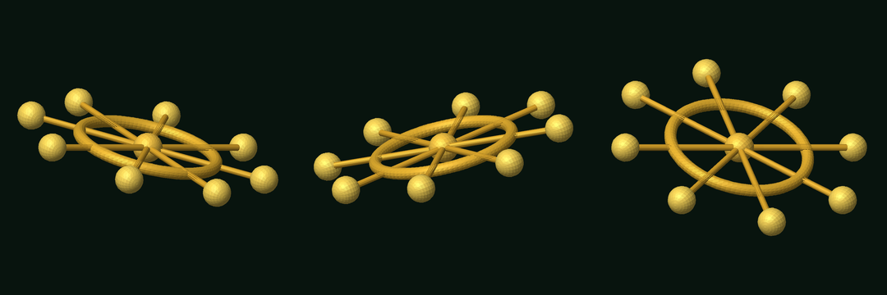

# Mahoraga Wheel

A BepInEx mod for **Casualties: Unknown**. Your body slowly adapts to whatever hurts you, a golden wheel over your head turns as it does, and if you survive long enough you can earn your way back to a brand new body.

Made by PettingDucks.

## Features

**Adaptation:** whatever directly hurts you slowly teaches your body to resist it.
- Every 3 minutes of being hurt by one kind of harm is one turn of the wheel. Damaging hits add a few bonus seconds.
- 4 turns (12 minutes) is full adaptation: that harm does 75% less to you. It never goes above 75%.
- 18 kinds of harm: impact, sharp, explosion, burn, cold, electric, energy, creature, radiation, sepsis, venom, brain (including living with brain damage), injury (broken, dislocated or missing limbs), general vitals, bleeding, infection, hunger and thirst.
- Your best adaptation also covers 40% of everything else, so you don't have to adapt to every little thing.
- Not adapted to: water pushing you around, and self harm.

**Healing:** the more adapted you are, the faster your body fixes itself, all the time.
- Wounds close, bleeding stops, infection shrinks, bones and joints mend faster, blood comes back.
- Breaks, dislocations and dismemberment become less likely.
- Adapting to infection slowly raises your immunity, up to 100.

**Renewal:** the long-term reward for surviving.
- Unlocks after 6 turns in total. A meter fills while you're fed, watered and not being hit, faster while sleeping.
- When it's full, temporary harm heals over 2 minutes (wounds, bleeding, infection, blood, bones, joints). It costs food and water, and pauses while you're in danger.
- Then permanent damage comes back over 10 minutes, one thing at a time, worst first: brain, lost limbs, eyes, hearing, disfigurement. Hits don't stop it; starving does.
- Lost arms and legs regrow piece by piece from the body outward, pixel by pixel: bone first, with flesh following behind. A growing piece can't be used or hit until it's done, and comes back weak (25 health) before healing up.

**The wheel:**
- A gold wheel floats over your head in the world, facing the way you face.
- It shudders while you're adapting, and turns with a piston sound when you earn a turn.
- The health menu shows a pixel wheel above your character, a symbol for each adaptation, and before/after numbers for the limb you're looking at.

**Fair play:**
- Dying resets everything.
- Food and water are never refilled for free.
- Each character and each world keeps its own adaptation, saved when you quit and loaded when you continue.

## How to install

1. Install [BepInEx 5](https://github.com/BepInEx/BepInEx) for Casualties: Unknown.
2. Put `MahoragaWheel.dll` in `Casualties Unknown\BepInEx\plugins\MahoragaWheel\`.
3. Start the game. The config file appears at `BepInEx\config\local.mahoragawheel.cfg` after the first launch.

The turn sound is played from the game's own sound files; no game assets are included here.

## Config

The main settings, in `local.mahoragawheel.cfg`:

| Section | Option | Default | What it does |
|---|---|---|---|
| Wheel | SecondsPerTurn | 180 | Seconds of being hurt for one turn |
| Wheel | MaxTurns | 4 | Turns until fully adapted |
| Wheel | GeneralResilience | 0.4 | Share of your best adaptation that covers everything else |
| Renewal | TurnsToUnlock | 6 | Total turns before Renewal starts |
| Renewal | MinutesAtFullSpeed | 25 | Minutes of calm survival per Renewal at full speed |
| Renewal | MendSeconds | 120 | Time to heal temporary harm |
| Renewal | PermanentMinutes | 10 | Time to restore permanent damage |
| Renewal | FoodCost / WaterCost | 25 | Food and water spent while mending |
| Wheel UI | HoverHeight | 1.45 | How high the wheel floats over your head |
| Wheel UI | ToggleKey | F8 | Show or hide the wheel |
| Sound | TurnSound | piston | Game sound played on each turn |
| Sound | Volume | 0.5 | Wheel sound volume |
| Saving | KeepAdaptationBetweenSessions | true | Save adaptation per character and world |

There are also testing options (off by default) under **Regrow Test** and **Sound Dump**.

## Building from source

`MahoragaWheel/build.sh` compiles every `.cs` file into `out/MahoragaWheel.dll` with the C# compiler that comes with Windows (.NET Framework 4). Edit the game path at the top of the script to match your install.

## Compatibility

- Built for the full release of Casualties: Unknown (Unity 2022.3, Mono) with BepInEx 5.4.
- Made for single player. Adaptation is kept per character, so multiplayer characters have their own, but multiplayer itself hasn't been tested.
